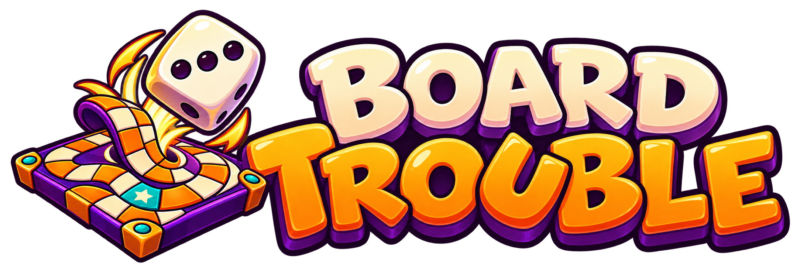

<p align="center">
  
</p>

# Board Trouble - serveur

Serveur de jeu de **Board Trouble**, un party game web : une course de plateau en 3D entrecoupée de mini-jeux, où tout peut se retourner jusqu'au dernier lancer.

N'importe qui peut lancer ce serveur, comme un serveur Minecraft :
- **sur le même réseau** : on lance l'exécutable, puis les joueurs ouvrent l'adresse affichée dans leur navigateur ;
- **par Internet** : sur un VPS, ou depuis chez soi à travers un tunnel.

Le serveur fait autorité : il applique toutes les règles, tire les dés et ne révèle à chaque joueur que ce qu'il a le droit de voir.

## État du projet

En conception. Le code arrive après la validation des documents de conception.

## Licence

[GNU AGPL-3.0](LICENSE) : tu peux héberger, modifier et redistribuer ce serveur librement. Si tu mets en ligne une version modifiée, tu dois publier son code source sous la même licence.

## Organisation

```
packages/core/      règles du jeu : plateau, dés, tours, portes, bots (TypeScript pur, tourne aussi dans le navigateur)
tools/simulator/    simulateur d'équilibrage : des milliers de parties entre bots
apps/server/        serveur réseau (à venir) : salons, reconnexion, modération, sauvegardes
```

## Développement

Prérequis : [Bun](https://bun.sh) 1.4 ou plus.

```
bun install         # installer les dépendances
bun run check       # lint et format (Biome), types (TypeScript), tests
bun run simulate    # simuler des parties : --games 2000 --table 4|6 --seed 1
```

Le moteur de règles est une fonction pure : il reçoit l'état de la partie et une intention ("je lance", "je prends ce chemin"), la valide, et renvoie le nouvel état avec la liste des événements à animer. Tout le hasard passe par un générateur à graine : une même graine rejoue exactement la même partie.
